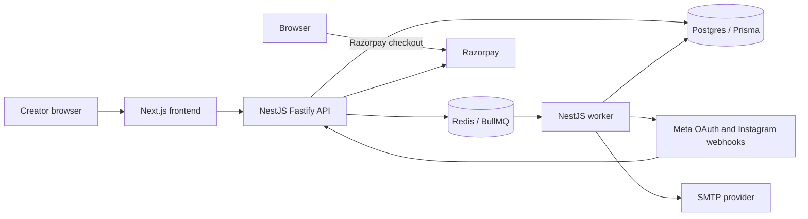

# HeyLaunch project overview

**Audit basis:** repository inspection through 21 November 2026. This document describes checked-in code and configuration; it does not imply that third-party accounts, Meta App Review, DNS, production secrets, or live infrastructure were inspected.

## Product

HeyLaunch is an early-stage SaaS for Instagram professional accounts. Its implemented core is comment/DM-triggered automation: a creator connects an Instagram account, configures a keyword or broad-match rule, and sends a text DM with optional link buttons. It also supports public comment replies, click redirects, delayed follow-ups, delivery logs, simple counts, plan limits, and manual one-time plan purchases.

## Runtime topology

The deployed API is `backend-nest/`, as configured in `render.yaml`. Its HTTP process enqueues Instagram events and its separate worker sends messages and refreshes tokens. `backend/` is a legacy Express implementation; Render and the current Docker Compose stack do not use it. The root `docker-compose.yml` now provides local PostgreSQL, Redis, Mailpit, active Nest API, worker, and Next.js frontend services; this is a development topology, not a production substitute. `frontend/Dockerfile` packages the standalone Next server. `nginx/nginx.conf` contains placeholder hostnames/cert paths. `replica/` contains product/design/recon notes, not runtime code.

## Verified stack

- Frontend: Next.js 15, React 18, TypeScript, TanStack Query, Zustand, Tailwind CSS, Recharts, next-themes.
- Active backend: NestJS 10 on Fastify 4, TypeScript, Zod validation, Prisma 6, PostgreSQL, BullMQ 5, ioredis, JWT, bcryptjs, Nodemailer, Axios.
- Payments: Razorpay SDK, Indian rupee prices in `backend-nest/src/common/plan.config.ts`.
- Deployment declared: Render web services plus a Render background worker; external Postgres and Redis connection URLs are required.
- API, worker, and frontend are pinned to Node `24.22.1` in `render.yaml`; both package manifests constrain supported local runtimes to Node 24. This matches Prisma 6's documented Node 24 support. The local verification environment used Node `24.13.1`; Render's exact pinned patch has not been deployed here.

## Main source areas

| Path | Responsibility |
|---|---|
| `frontend/app/` | Public landing pages, auth pages, dashboard routes |
| `frontend/components/`, `frontend/services/`, `frontend/store/` | UI pieces, API client, client auth state |
| `backend-nest/src/auth/` | Signup, login, refresh, OTP, password reset |
| `backend-nest/src/instagram/` | Instagram Login OAuth, account/media API, token refresh |
| `backend-nest/src/webhook/` | Meta webhook verification and enqueue orchestration |
| `backend-nest/src/automations/` | Automation validation, CRUD, matching helpers, analytics |
| `backend-nest/src/queue/` | BullMQ setup and DM/follow-up execution |
| `backend-nest/src/meta/` | Instagram Graph API message/comment calls |
| `backend-nest/src/payments/`, `common/plan.config.ts` | Plan catalogue, checkout, browser verification, signed capture webhook |
| `backend-nest/prisma/` | PostgreSQL schema and migrations |
| `render.yaml`, `docker-compose.yml`, `nginx/` | Hosting/container/reverse-proxy declarations; not all are in the active Render path |

## Important end-to-end flows

### Account registration and login

Signup creates a bcrypt password hash, stores an expiring email OTP digest, and transactionally queues its encrypted email payload in Postgres. The worker checks the current OTP/reset token, sends due mail, retries SMTP failures with bounded backoff, and cancels expired or superseded credentials. OTP verification is required for protected product operations. Login issues short-lived JWT access and rotating refresh cookies/tokens. `refresh_tokens` stores SHA-256 digests and a per-device family ID; concurrent reuse revokes only that family, while password reset deliberately revokes all sessions. Migration 32 has been applied to development/testing Neon and preserved all three current rows as separate families; staging/production migration remains pending. Password reset stores a one-way token hash and transactionally queues the encrypted reset link; reset expires the token and removes refresh tokens after password replacement. SMTP acceptance is not proof of inbox delivery, and a crash after acceptance may cause a duplicate message.

### Instagram comment to DM

Meta sends a signed POST to `/webhooks/instagram`. The controller checks `X-Hub-Signature-256` against the raw body, persists each comment/message event in one batch insert, bulk-enqueues eligible event IDs, then acknowledges. The endpoint accepts up to 5 MiB; its request cap and generic-throttle exemption are documented in the security review. The worker processes durable receipts; a 10-second reconciliation job re-enqueues pending database receipts if Redis queue state is lost. `WebhookService` locates the connected account, applies current plan entitlements, finds live matching automations, atomically reserves monthly user and daily automation quota, and enqueues a BullMQ send job. The DM worker rechecks current entitlements and automation/account status, upserts a contact, reserves a shared Redis rolling-window slot before comment-triggered private replies, optionally replies publicly to the comment, sends text plus URL buttons through `MetaService`, records the run, increments contact usage, and schedules only entitled follow-ups. Private replies are capped at 700 per account per hour, below Meta's documented 750 per hour. Saturated jobs are delayed without consuming retries. Each follow-up gets its own quota reservation and delivery record. Exhausted or stale primary/follow-up runs become `UNKNOWN` when delivery cannot be confirmed.

The queue uses five exponential-backoff attempts. A primary or follow-up run is written as `PENDING` before contacting Meta. If worker retries exhaust or a pending run remains for 15 minutes, the worker marks it `UNKNOWN` and tells the creator to check Instagram. A crash after Meta accepts a message but before the DB records `SENT` can still result in a duplicate on retry. Queue/job IDs reduce duplicate enqueueing but do not provide exactly-once delivery with Meta.

### Payment

The API creates a Razorpay order with server-owned plan and user notes. Checkout runs in the browser. Browser verification checks the checkout HMAC; the public capture webhook validates Razorpay's raw-body HMAC. Both paths fetch the order and payment from Razorpay, check owner/plan/amount/currency/captured status, store the payment uniquely, and extend the access period in one database transaction. This depends on deployed Razorpay credentials, webhook setup, and is not live-provider verified. Plan purchase is a 30-day one-time access grant; automatic recurring billing is not implemented.

## Current implementation boundaries

Implemented automation content is plain text and up to three URL buttons. Click tracking is available for configured button URLs. Keyword/ANY matching is local and deterministic. The owner-scoped contact inbox supports search, pagination, private notes/tags, and CSV export. Segmentation and lead attribution are absent. AI matching, collect-email flow, reliable follower gating, media attachments, agency workspaces/team seats, and a complete inbox are not implemented. Unsupported automation options have been removed from the new-automation UI and server validation rejects them where applicable.

`frontend/app/(dashboard)/dashboard/campaigns/` redirects to automations; it is not a separate campaign feature. Verified users can submit and track support requests and feedback in persisted threads, and admins can reply from the protected support inbox. Admin replies queue encrypted customer email notifications; support/feedback submissions and customer replies can alert the optional `SUPPORT_NOTIFICATION_EMAIL`. Delivery depends on SMTP configuration, and no response SLA is set. General product notifications are assembled from API state in the browser, not persisted push/email notifications.

Account export is available in Settings. Self-service deletion rechecks the current password and typed email, immediately replaces profile/login data with a non-routable tombstone, blocks authenticated sessions, clears stored Instagram credentials, disconnects accounts, and pauses automations. After an operational 15-minute processing delay, the worker removes queued/delayed account jobs and webhook receipts, waits around active account jobs, deletes account-owned data, detaches transaction rows, and deletes the user row. The delay is not cancellable, and no restore path exists. Financial transaction identifiers remain without a user link; provider-side token revocation and staging migration/queue behavior remain unverified.

## Review coverage and limits

This onboarding pass mapped the tracked source/configuration inventory and inspected the active Nest modules, Prisma models/migrations, deployment blueprint, auth/Instagram/webhook/automation/queue/payment flows, and dashboard route implementations. Builds and existing backend tests were run. The public landing and signup pages received a narrow-viewport visual check, without submitting signup. Follow-up browser review covered authenticated dashboard Overview and Instagram pages; other dashboard routes were not exhaustively visually audited. Legacy Express internals, generated/dependency files, external provider dashboards, live API permissions, and production database state were not exhaustively validated. See the feature and security documents for open verification items.
